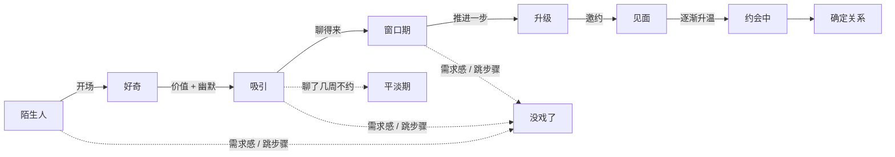

<div align="center">

# 💬 dating-coach · 恋爱教练

### 每一条建议，都有研究和数据撑腰的恋爱教练

**一个 Claude Code 技能：告诉你微信该回什么、什么时候约、什么时候该放手，而且每条规则都给过研究打分。**

**🌐 [English](README.md) · 中文**

[](https://docs.claude.com/en/docs/claude-code/skills)
[](references/zh/evidence.md)
[](#-20-条流行说法研究打分)
[](#-它不会教你的东西)
[](https://linux.do)
[](LICENSE)

</div>

---

市面上的恋爱建议，要么是**玄学**（"自信点就行了兄弟"），要么是**套路**（"先打压再冷她三天"）。这个技能两样都不是。

它把 **16 小时以上的真实实战教学**（街头搭讪、约会复盘、微信聊天记录逐条拆解）整理成一套完整方法，再拿去和学术研究逐条对照：**20 条最流行的恋爱说法，用 26 篇已发表研究打分**。8 条有支持，6 条存疑，5 条被否定，1 条暂无证据。站得住的留下，站不住的删掉，所有操控性的套路都换成效果一样、但真诚的版本。

最后，它变成一个会直接告诉你**下一句发什么**的教练。

## ⚡ 实际效果

> **你：** 第一次约会挺顺的，第二次约在下周六了。这一周我要不要找她聊？还是等她先找我？

> **dating-coach：** 要聊，但轻一点。别憋着等她，也别一整天黏着聊。
>
> **今晚或明天：** 发一条短的，带上约会里的一个梗：
> > 今天挺开心的，你那个[某个观点]我到现在还在笑 😂
>
> **周中：** 轻轻聊一两次，聊得正开心的时候你先收（高点撤离）。
> **周四/周五：** 确认时间地点，顺手发个定位。计划由你来定。
>
> **她话多 →** 你也可以多聊点。**她话少 →** 保持轻松。**没回 →** 千万别连发。
>
> **别再故意晚回了。** 不确定感只在刚认识时有点用。约会顺利、她也答应了第二次，这时候再玩欲擒故纵，只会让她觉得你冷了 *(Whitchurch 等, 2011; Montoya & Insko, 2008)*。

每个回答都是同一个结构：**结论 → 计划 → 用你自己的语气写好、可直接复制的消息 → 她不同反应时你分别怎么做**。

## 🧠 和别的"恋爱话术"有什么不一样

| | 一般的话术机器人 | **dating-coach** |
|---|---|---|
| 依据 | 感觉、某个大师的一家之言 | 实战方法 **+ 26 篇研究**，每条说法都打过分 |
| 输出 | 5 句通用土味情话 | 诊断问题、给出计划、**用你的语气写好消息**，并按她的不同反应给出下一步 |
| 她不回了怎么办 | "再发一条！" | **三档止损方案**，有明确的触发条件，也有体面收尾的话术 |
| 欲擒故纵 / 忽冷忽热 | 奉为真理 | 用模型算过：**只在开头有用**，而且只能是一条由冷到暖的弧线 |
| 她说"不" | 常被当成"测试" | **当成真实信息。** 并说明为什么把每个"不"都当成"有戏"，等于根本没在听她说话 |
| 操控套路 | 打压、冷读、灌酒 | **一个都没有。** 全部换成效果更好的真诚版本 |

## 🗺️ 阶段模型

所有情况都放在同一条流程上，所以教练能告诉你**你到底卡在哪一步**，而不是给一堆泛泛的技巧。



- **木桶效应：** 最终成功率是每一步通过率**相乘**，所以补最弱的那一步，比打磨最强的那一步收益大得多。照片都过不了关，聊天再会也没用。
- **"油腻"其实是时机问题：** 同一句话，女朋友说是甜，陌生人说就是油。对的话放在错的阶段，就会被扣分。
- **拖着本身就是成本：** 兴趣会随时间衰减，聊了几周还不约，有个专门的名字：*平淡期*。

## 📐 20 条流行说法，研究打分

<details>
<summary><b>点开看完整打分表</b></summary>

| 说法 | 结论 |
|---|---|
| 多追问、互相分享自己的事 | ✅ 强支持 (Aron 等, 1997) |
| 约会要多样、有新鲜感 | ✅ 支持 (Aron 等, 2000; Dutton & Aron, 1974) |
| 幽默是核心吸引力 | ✅ 支持 (Bressler 等, 2006) |
| 要有选择性，别对谁都好 | ✅ 支持 (Walster 等, 1973; Eastwick 等, 2007) |
| 先冷后热 | ✅ 支持 (Aronson & Linder, 1965) |
| 给个理由，请求更容易被答应 | ✅ 支持 (Langer 等, 1978) |
| 先提小请求，再提大请求 | ✅ 支持，即登门槛效应 (Freedman & Fraser, 1966) |
| 炫豪车吸引的是短期关系 | ✅ 支持 (Sundie 等, 2011) |
| 让她捉摸不透，她就会一直想你 | ⚠️ 提高的是"想要"，不是"喜欢" (Dai 等, 2014) |
| 女生主要看钱和地位 | ⚠️ 问卷里是这样，真实见面选择时影响很弱 (Eastwick & Finkel, 2008) |
| 老实人吃亏 | ⚠️ 长期看基本不成立 (Urbaniak & Kilmann, 2003) |
| 具体的夸奖比笼统的好 | ⚠️ 有间接支持 (Reis & Shaver, 1988) |
| 越难得到越珍惜 | ⚠️ 有努力合理化效应，但没在恋爱里验证过 |
| "十个男的抢一个女的" | ⚠️ 夸大了 |
| 永远别表现出喜欢，要高冷 | ❌ 被否定：喜欢是相互的 (Montoya & Insko, 2008) |
| 永远别道歉 | ❌ 被否定 (Gottman, 1994) |
| 让她有点怕你 | ❌ 被否定 (Cheng 等, 2013) |
| 认识越短越好 | ❌ 被否定 (Zajonc, 1968) |
| 犹豫就是同意，拒绝都是测试 | ❌ 被否定，而且危险 (Muehlenhard & Hollabaugh, 1988) |
| 聊崩了一周就忘了 | ❔ 经验法则，未经验证 |

**规律：** 讲*过程*的建议基本都站得住：节奏、幽默、好奇心、主导、多样的约会、没有需求感。把恋爱当*对抗*的那套世界观站不住：把拒绝当游戏、装高冷、靠压制。

</details>

## 🧮 规则背后的模型

这个技能不只是告诉你规则，还知道这些规则*什么时候才成立*：

- **回消息有个最佳时间。** 晚一点回说明你有自己的生活，及时回应又能拉近距离。两者的权衡 `U(τ) = v(1−e^{−τ/a}) + r·e^{−τ/b}` 存在中间最优点，所以实用的规则是"跟她的节奏"，而不是"等三小时再回"。
- **先模糊邀约。** 如果直接约被拒会让以后更难约，那么一旦这种影响够大，先来一句不费力的"改天一起去…"就是最优的第一步。
- **忽冷忽热。** 在得失效应下，只有*第一个和最后一个*信号有影响。来回反复不会多加分，一条由冷到暖的弧线才是赢法。
- **背熟的接招话术会失效。** 大家都背同一套答案时，答案本身就说明不了你自信。只有真正稳的状态，才经得起一次次测试。
- **80/20/0 花钱法则。** 早期送的礼物如果抬高她的其他选择，多过增加她对你的满意度，那么送礼的最优投入就是零。钱花在提升自己和一起经历的事情上。
- **为什么"不"必须算数。** 如果每个回答都被理解成"有戏"，这种解读就不含任何信息。概率上，"不"是证据；道德上，"不"就是结论。

## 📦 里面有什么

| 文件 | 内容 |
|---|---|
| [`SKILL.md`](SKILL.md) | 教练流程、阶段模型、15 条核心原则、底线、路由 |
| [`zh/texting.md`](references/zh/texting.md) | 微信聊天节奏、回复时间、约会之间怎么聊、重启聊死的天、**聊天记录分析格式** |
| [`zh/dates.md`](references/zh/dates.md) | 3–5 站的约会安排、升级与同意、第二三次约会、确定关系、被放鸽子 |
| [`zh/conversation.md`](references/zh/conversation.md) | 搭讪与软件开场白、朋友圈与头像、钩子-展示-释放、怎么接测试 |
| [`zh/recovery.md`](references/zh/recovery.md) | **三档止损方案**、体面收尾话术、走出沉没成本 |
| [`zh/relationship.md`](references/zh/relationship.md) | 吵架修复、"你从来不陪我"、长期关系里程碑（见家长、彩礼、买房） |
| [`zh/evidence.md`](references/zh/evidence.md) | 研究打分和上面这些模型 |
| [`zh/catalog.md`](references/zh/catalog.md) | 全部技巧、信号、话术和经验数字，每条都标了证据等级和是否操控 |

所有文件都有中英两版，英文在 `references/`，中文在 `references/zh/`。

## 🚀 安装

```bash
git clone https://github.com/nelonmelons/dating-coach-skill.git ~/.claude/skills/dating-coach
```

就这一步。之后你问恋爱、聊天、感情相关的问题，Claude Code 会自动调用它；也可以直接输入 `/dating-coach`。**用中文问就用中文答**，话术是微信语境，例子用的是奶茶、剧本杀、朋友圈。

### 可以这样问

- *"这是我们的聊天记录[粘贴]，她回得越来越慢了，我下一句发什么？"*
- *"探探上聊了 4 天，怎么约她出来才不尴尬？"*
- *"她把第二次约会鸽了，也没说改哪天，我要回吗？"*
- *"她说'你是不是对每个女生都这么说'，怎么接？"*
- *"在成都约第一次会，除了吃饭看电影还能去哪？"*
- *"女朋友说我从来不陪她，可我一周上 60 个小时班"*

## 🛡️ 它不会教你的东西

打压（PUA 式的 neg）、冷读话术、假人设、"不经意"的身体接触、借她闺蜜让她吃醋、灌酒、把"不确定"当成害羞、被删之后换号加回来。

不是因为假清高。**这些套路站不住：** 要么一旦真认识就穿帮，要么拿到的"同意"不是她自愿给的。你要是问到这类套路，教练会给你效果一样、但真诚的做法，再用一句话说明为什么它更好用。

## ⚠️ 坦白说说局限

大部分研究来自西方样本，很多是大学生，在实验室或快速约会场景里做的，效应量也都不大。具体的时间数字（"三次约会"、"一周冷却"）是经验法则，技能里也是这么标注的。模型只能说明一条规则*在什么条件下*最优，不代表它永远成立。默认例子是男生追女生，但原则是通用的，教练会按你的情况调整。

## 🤝 欢迎贡献

欢迎 PR，特别是：
- 新的、**带引用的打分说法**
- 教练回答得不好的**场景话术**
- 针对不同文化、平台、性取向的改编

如果它帮你约到了第二次，**⭐ 点个 Star**，这是别人能找到它的唯一方式。
